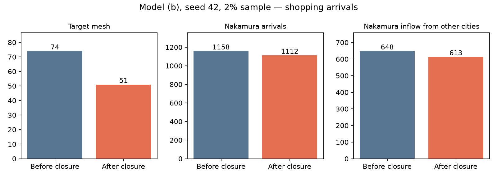

# (b)モデルのJava導入と閉店baselineの入力監査

2026-10-14 JST。本チャットの本人指示（NEXT先頭・DECISIONS夕方）に従う。主方式A、生成CSVの変更・人数枠・来訪者選び直しなし。

## 採用モデルと単位

`output/gamma_telepoint_3402/gamma_estimation.json` の `transforms.log1p_area.models.b` を数値を丸めず採用。
γ=0.011720855296350972、β=0.43590586364374384。
研究室係数の倍率は距離0.9171120757320695、面積−0.08266305088851081、人口比−4.266766913696244、オフィス比−0.9742489937064989。同一市区町村項は研究室値。

指標は **TelePoint BUSC3402系の行数**。元JSONの `indicator_input_unit=m2`、`new_facility_area_m2`、`nakamura_feature_increment_54374m2` は面積推定コードの残存メタデータで、この推定には使わない。元推定結果は保存し、`config/gamma/adopted_b.json` に採用と単位を明記。
面積54,374㎡は従業者相当の計算に使い、γへ54,374行として加算しない。

Javaは `--shopping-gamma-config JSON` で `γ × ln(1+indicator)`（またはpresence）を買物の都市効用へ独立加算。引数省略時γ=0。入力ゼロを明記し、欠損都市・負値・非有限値はエラー。
愛知県境の選択肢を欠損扱いしないよう、同じ業種・行数ルールを全国1,902自治体へ適用。採用推定に使った愛知69自治体は元指標と一致を検査。県外への係数適用は外挿であり、県外需要の検証ではない。

## 閉店対象と未解決のメッシュ不一致

`pflow_closure_config.py` 実行結果は `config/gamma/closure_input_audit.json`。小売CSV SHA256=`10f4b5ccfb6a0da09c08837a83b586f8eba8f0cea3d0b3a45edb32b905d0e316`。

| 条件（中村区・BUSC3402系） | 除外行数 |
| --- | ---: |
| 名駅1丁目2−1 完全一致 | 140 |
| 名駅1丁目2−2 完全一致 | 103 |
| 名駅1丁目2−4 完全一致 | 63 |
| 合計 | 306 |

階数付きの別住所は除外しない。γ指標は325→19。
候補除外はJavaが住所・業種情報を捨てる前に行い、実除外数が期待306行と違えば生成前に停止する。元入力ファイルは変更しない。

**306行すべてが現行Javaの定数座標シフト後には52365790に入る。指定の52366700ではない。**
これは現行コード上の座標であり、実地の測地系の正しさを確認したという意味ではない。
`mesh_ecensus.csv` の買物capacityは52365790=2,141（23110・23105共有）、52366700=22,230（23104・23105共有）。
減算量は54,374×65,068÷4,743,000=745.942954248366。
どちらから減算するか本人へ確認中。`config/gamma/meitetsu_closed.pending.json` は指定どおり52366700の暫定案で、実行しない。
閉店前後の生成・最適化・全数結果はまだない。除外が終わったとは報告しない。

## 検証

- γ追加直後の既定生成：`.local/pflow/output/gamma_default_20261014/baseline/23`。従来 `.local/pflow/output/capacity_experiment/baseline/23` と `diff -rq` 差分なし、207 CSV。
- 閉店オプション込みの最終既定生成：`.local/pflow/output/gamma_closure_default_20261014/baseline/23` も従来207 CSVと完全一致。ログの `[ERROR]`・`Unresolved compilation` なし。再実行コマンド・ハッシュは `20261014_gamma既定互換性.json`。
- Python全テスト：139件成功（プロジェクト直下で `.venv/bin/python -m unittest discover -s tests`）。
- Java最終テスト：17件成功。γ・住所限定除外・減算・既存フィルター・B再生の回帰を含む。

## 次の実行

1. capacity減算先を本人確認。必要なら閉店減算メッシュと新施設加算メッシュを別指定できる設定へ拡張。
2. 採用(b)で閉店前／閉店後のbaselineを同seedで生成し、店舗・メッシュ・市区町村増減を監査。
3. 閉店後を出発点として期待値近似→2%seed42〜45→補正→全数seed42へ進む。大型店分岐の係数も採用(b)と整合させ、従来の距離0.45等を無断で混ぜない。
4. 目標人数・PT分布への校正と外部検証を区別。B比較は閉店前基準の既存結果との差に注意する。

## 保存・push状況

Java `55c755e`、研究 `311c8ad`、週報 `e564a37` にローカルcommit済み。pushを実行したが、Javaの `mine` は Repository not found、研究・週報のoriginは認証アカウント `itsterm4watanabea-max` の権限不足403。認証変更はしていない。リモート反映は未完了。

## 本人回答後の実行（2026-10-14）

- 減算先・新施設は52365790へ統一。旧本館の raw (136.88694375,35.16638356) に現行Javaシフトを適用した (136.88665075,35.16649051)。`config/gamma/analysis_target.json` に位置・施設ID900000001を保存。
- 本館座標には除外対象外の店舗行も残るため、座標一致を新施設到着と数えない。任意traceに `facility_id` を追加し、生成CSV10列は保持。既存B読込は旧5列traceと新6列traceの両方に対応。
- `AnalysisTarget` を集計APIへ渡し、対象メッシュ・都市・座標・施設IDを設定化。ID指定時はtrace必須、欠損時に座標へ代替しない。
- 採用(b)を普通買物／大型店分岐へ共通適用。同一市区町村倍率1、従来大型店割合0.22389070848047118を維持。閉店前後の全係数・乱数seedは同じ。
- 閉店前後2%seed42の結果・実行コマンドは `.local/pflow/output/gamma_closure_52365790_20261014/{baseline_metrics.json,commands.json}`。対象メッシュ74→51、中村区1,158→1,112、直前地点が区外の流入648→613。日次人数へ単純50倍した確定値ではない。
- 施設ID追加後の既定207 CSVも `default/baseline/23` と従来baselineの `diff -rq` で一致、生成ログのERRORなし。
- 期待値近似はbaseline買物39,965件の直前地点を固定して確率を計算。後続移動と活動数の変化は実生成で確認し、全体の人数比1個だけでフィードバック。地区別係数は追加しない。
- 探索範囲：γ加算0〜3,000行、距離倍率0.3〜1.5、meshCapacityAdd 0〜60,000、施設capacity 1,000〜1e9。12,000加算上限の試算では6,000目標に不足するため拡張。大きな加算を実施設の従業者数と解釈しない。
- 目的関数は人数相対誤差²＋0.1×施設出発地TVD＋1.0×愛知内ODの行き先TVD。施設capacityを期待人数に合わせて内側で解き、残る3入力を多始点Nelder–Mead探索。上限未達も報告。これは4入力を変える期待値計算であり、人物への枠割当てではない。
- 初回3,000候補：期待2,999.978件、出発地TVD0.466113、行先TVD0.088236。`.local/pflow/output/gamma_A_52365790_20261014/report.json`。実生成の成否・全数は未確認。

最適化で距離倍率が動くため、施設効果と係数変更を混同しないよう、最終係数と同じ距離倍率の閉店前・閉店後controlを生成する。`pflow_gamma_controls.py` は2%で閉店前後、全数で閉店後を生成し、新施設ありとの非来訪者変更を監査する。未実行。

期待値近似v1の追加監査：経済センサス＋小売で作ったメッシュ所属と、病院・飲食店の追加所属との間に愛知6自治体の差（買物capacity 51/34/133/37/360/510）があった。中村区・中川区の所属には差なし。v1はこの小さい境界差とJava距離関数との差を持つ近似で、実生成と同一確率とは主張しない。修正版の感度も確認する。

病院・飲食店所属を反映したv2との感度：初回3,000候補の期待人数は2,999.978→2,998.765（−1.213件、約−0.04%）、出発地TVD0.466113→0.466094、全県行先TVD0.088236→0.088136。進行中v1の実生成は保持し、近似の境界所属差を報告する。v2 cache再構築CLIを追加した。
