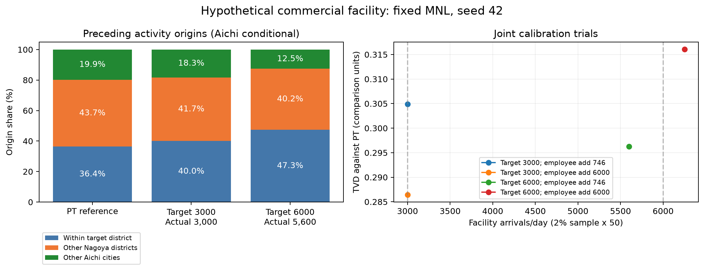
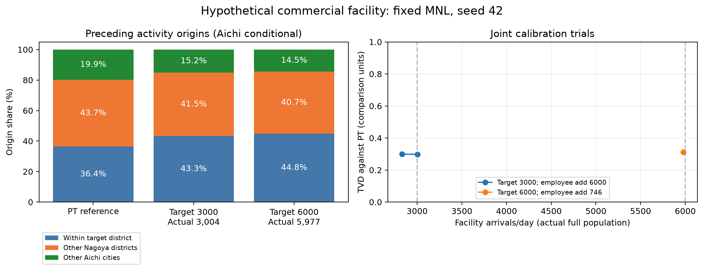

# 仮想商業施設：3,000・6,000到着の校正試行（2026-10-14）

## 目的と条件

本人の指示により、仮想新施設への買物到着3,000・6,000トリップ/日と、用意済みPTの直前活動地点分布を目標として実行。来訪実人数・居住地分布ではない。
AIを実行中に用いず、Pythonが商業量増分の候補と施設capacityを評価する。Java・MNL係数は変更しない。商業量の2水準を試し、人数±10%内の候補で細かなPT出発地TVDが小さいものを選択。人数未達時は容量比の逆算または挟み込み補間で施設capacityを更新する。これは限定探索で、最適性・達成可能性の保証ではない。
商業量は卸売・小売従業者のメッシュ値への加算。約746と6,000を使用。6,000は過去の感度条件に基づく仮定で、計画の雇用予測ではない。施設capacityは店舗選択の相対重みで人数ではない。
一般MNL・大型店MNLは引き継ぎ設定を固定（大型店β=0.3984375、距離倍率0.45、集積項p=2,q=0、都市一致on、区内raw）。地区・メッシュ・店舗の選択を生成モデルの中で変更し、生成後の目的地選び直しは行わない。
PTは中ゾーン5着・大型規模小売店・買物の20,796トリップ。出発地が愛知県内の部分へ条件化して校正し、県外を含むTVDもJSONに保存。仮想施設単独の実測値ではなく、校正入力としての代理分布。
愛知県内に条件化した参照の3区分: 地区内36.36%、名古屋市内他地区43.73%、名古屋市外の愛知県19.91%。

## 2%・seed42の実行結果

| 目標/日 | 商業量増分 | 施設capacity | 標本到着 | ×50換算 | TVD（39比較単位・愛知内） | TVD（3区分） |
|---:|---:|---:|---:|---:|---:|---:|
| 3000 | 745.943 | 644000 | 60 | 3000 | 0.305 | 0.053 |
| 3000 | 6000.000 | 505000 | 60 | 3000 | 0.286 | 0.036 |
| 6000 | 745.943 | 1610000 | 112 | 5600 | 0.296 | 0.110 |
| 6000 | 6000.000 | 1199000 | 125 | 6250 | 0.316 | 0.092 |

4ケースすべて完了、各207 CSV。人数は全候補が探索上の±10%内だったため、2巡目の追加生成は発生しなかった。細かなTVD≤0.15という仮の目安は、いずれも未達。



### 採用候補の転換元・活動監査

- 目標3000: 換算3000、商業量+6000.000、施設capacity 505000。店舗所在地ベースの地区全体の買物は1224→1272。新施設到着の転換元: `{"same_mesh": 44, "other_mesh_same_physical_city": 12, "outside_physical_city": 4}`。
  活動日時・目的等の一致: 140556/140569人。13人は一致せず、全活動の完全固定とは言えない。新施設への到着は全件、同じ日時・目的のbaseline買物と対応付けできた。
- 目標6000: 換算5600、商業量+745.943、施設capacity 1610000。店舗所在地ベースの地区全体の買物は1224→1232。新施設到着の転換元: `{"same_mesh": 109, "other_mesh_same_physical_city": 3}`。
  活動日時・目的等の一致: 140567/140569人。2人は一致せず、全活動の完全固定とは言えない。新施設への到着は全件、同じ日時・目的のbaseline買物と対応付けできた。

3,000候補では商業量を増やして地区外店舗からの転換4件を確認。一方、6,000候補は同メッシュ転換109/112件。PTの出発地分布への適合は、地区外店舗からの転換や地区への純流入増を保証しない。

### 少数標本の診断

参照PTから独立多項抽出を10,000回行う診断（seed42、39比較単位）。PTをそのまま抽出してもTVD中央値はn=60で0.234、n=120で0.167。95%範囲はそれぞれ0.171〜0.310、0.123〜0.224。これは生成モデルの統計検定・外部検証ではない。少数標本の細かなTVDに合わせ込む危険があり、粗い3区分と全数結果を併記する。

## 全数確認・人数の自動修正

2%で選んだ候補を愛知県全数・seed42で実行。3,000目標は最初2,830件だったため、コードが容量比を逆算して施設capacityを505,000→540,000へ更新。再実行で3,004件。6,000目標は最初から5,977件で、最終目安±2%内のため追加生成なし。全数は計3ケース、各207 CSV。全数人数を目標へ近づけるフィードバックはAIなしで行った。

| 目標/日 | 実到着 | 符号付き誤差 | 商業量増分 | 施設capacity | TVD（39単位） | 地区内 / 市内他地区 / 市外 |
|---:|---:|---:|---:|---:|---:|---|
| 3000 | 3004 | +0.13% | 6000.000 | 540000 | 0.298 | 43.3% / 41.5% / 15.2% |
| 6000 | 5977 | -0.38% | 745.943 | 1610000 | 0.312 | 44.8% / 40.7% / 14.5% |

人数は達成したが、PT出発地分布は一致していない。参照の地区内36.4%に対して43.3%・44.8%と高く、市外19.9%に対して15.2%・14.5%と低い。39比較単位のTVDは約0.30。



### 転換元・地区全体への影響（店舗所在地で監査）

| 目標 | 同じメッシュの店 | 地区内別メッシュの店 | 地区外の店（確認できた件数） | 不明 | 活動対応不成立 | 地区全体の買物到着 |
|---:|---:|---:|---:|---:|---:|---|
| 3000 | 2431 | 378 | 183 | 11 | 1 | 61333→63344 |
| 6000 | 5788 | 134 | 54 | 1 | 0 | 61333→61572 |

3,000条件は同メッシュ転換80.9%、地区外店舗からの確認済み転換6.1%。6,000条件は同メッシュ転換96.8%、地区外店舗からの確認済み転換0.9%。商業量増分が異なる条件であり、需要を増やすと転換元がこう変わるという因果比較ではない。総到着数、直前活動地分布、転換元、地区の純増を区別する必要がある。

### 活動固定の監査

- 目標3000: 7,023,479人中、7,022,880人で活動日時・目的等が一致。599人は不一致。施設到着でbaselineの同じ活動へ対応付けできなかったのは1件。
- 目標6000: 7,023,479人中、7,023,371人で活動日時・目的等が一致。108人は不一致。施設到着でbaselineの同じ活動へ対応付けできなかったのは0件。

Markovモデルを変更していないが、現行の再生成は全活動の完全固定を保証しない。固定した活動から目的地だけを再選択する処理と、人単位生成失敗・分岐による差の監査が次の課題。

全数と同件数の独立PT抽出診断でTVD中央値は3,004件で0.033、5,977件で0.024。生成結果の約0.30は少数標本だけの誤差として扱わず、モデル・参照条件を見直す。独立抽出診断は外部検証や生成モデルの統計検定ではない。

生出力: `/Volumes/PFLOW_SSD/PFLOW/output/joint_target_20261014_3000_6000/` と `joint_target_20261014_3000_6000_refined/`。監査済み集計は同名JSONへ保存。

## MTGで示せる結論

- 仮想施設の需要3,000・6,000到着へ、コードによる人数フィードバックで±0.4%以内に近づけた。
- 商業量・施設capacityだけの今回の限定探索では、PT出発地分布との同時一致は未達。
- 来訪数の達成から、地区外店舗からの転換や地区への純流入増を推論できない。
- 既存Javaの大型店限定フィルターの問題と活動固定の不一致があるため、現段階は予備実験。発表用の検証には修正・再実行が必要。

## 実装・検査と制約

- 新規処理: `pflow_joint_target_calibration.py` と `pflow_joint_target_verify.py`、7つの数値探索・停止条件テスト。既存を含むPython120テスト成功。
- Java変更なし。初回の3GB・2並列はヒープ逼迫で中止、未完了出力は評価から除外。6GB・1並列で実行。
- 既存Javaの `choiceFacility` は、大型店限定で作ったpoolを都市一致時に元のfacilitiesから作り直すため、一般買物分岐でも新施設が選ばれる場合がある。現実装の挙動を保持した試行であり、「大型店分岐だけ来訪する」という制約の成立を主張しない。修正と再検査が必要。
- PT分布は校正入力。seed42のみ。需要から床面積・実雇用量を予測する式を検証したものではない。

## 再現

```bash
.venv/bin/python pflow_joint_target_calibration.py --targets 3000 6000 \
  --pt-csv ../中京PTデータ/chukyo_pt_2022_od_d5_shopping_facility_age.csv \
  --output .local/pflow/output/joint_target_reproduction --rounds 2 --workers 1 --verify-full
```

校正の報告・各シナリオ・コマンド・生ログ・図・監査JSONは `.local/pflow/output/joint_target_20261014_3000_6000_xmx6g/` に保存。全数確認はその中の `verify_full.py` と `full_verification/`。

`--verify-full`で2%探索から全数確認・人数±2%への自動修正まで一つのコマンドで実行する。探索打切り時は誤差と達成フラグを返し、任意の人数・PT分布への到達を保証しない。
