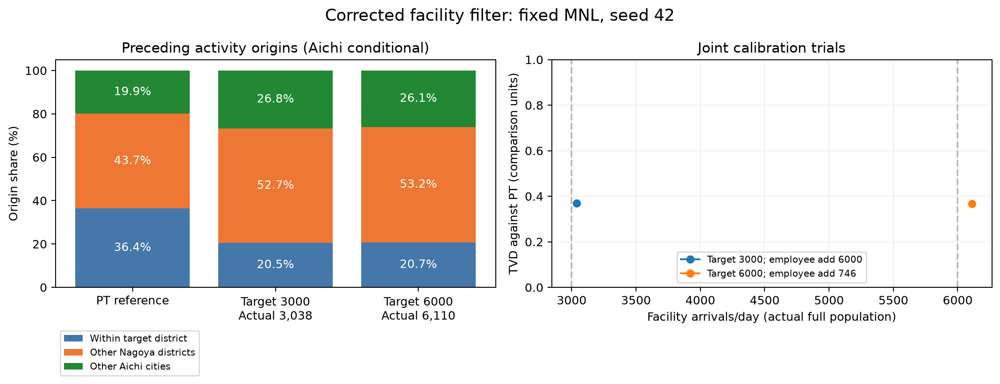

# 大型店限定フィルターの修正と再校正

2026-10-14 JST。本人からClaudeの原因説明を受領し、修正と3,000・6,000件の再校正を依頼された。

## 修正と検証

`Pseudo-PFLOW-v3/src/pseudo/gen/ActGenerator.java` の `choiceFacility` で、都市一致の候補走査を `facilities` から `pool` へ変更。大型店限定で除外した新施設を都市一致で復活させない。同じ市の候補がない場合もフィルター済みpoolを維持する。JavaのCRLFは維持。

`src/test/java/pseudo/gen/FacilityFilterTest.java` の4ケース:

- 通常買物で、同じ市の新施設を再び候補にしない。
- 同じ市に新施設しかなくても、別市の既存店から選ぶ。
- 大型店買物では新施設を選べる。
- 既定offでは元の候補を維持する。

修正前: 4件中2件失敗（通常買物が新施設の座標を選択）。修正後: 4件成功。実行: `bash scripts/test_facility_filter.sh`（Pseudo-PFLOW-v3）。通常のMaven testは既存truckテストのAPI不整合でコンパイルできないため、元のpomを変更せず一時pomで今回のテストだけをコンパイルする。

Python: `.venv/bin/python -m unittest discover -s tests`、120件成功。

## 既存結果の扱い

17,965件、および以前の3,004・5,977件は修正前の値として保存。「大型店買物のみが来る」設定の結果として使用しない。修正前の原始CSVを上書きしない。

## 実行手順

既定off・seed42・2%で再生成した207 CSVは従来出力と完全一致（`diff -rq`終了0、差分0）。出力: `.local/pflow/output/facility_filter_fix_20261014/default_check/baseline/23`、比較元: `.local/pflow/output/capacity_experiment/baseline/23`。記録: `default_verification.json`。

容量1e9、商業量増分745.943、採用MNL固定で修正後の到着数を測定し、再校正の基準値に使用した。

作業出力: `.local/pflow/output/facility_filter_fix_20261014/`。実行ログ・設定・集計を保存済み。確認済みの結果は以下に記載。

Javaコミット: `a118854`（ローカルのみ、pushなし）。

## 修正後の高capacity試行（確認済み）

容量1e9、商業量+745.943、採用オプション、2%・seed42: 施設到着122件（全数換算6,100件、実際の全数ではない）。207 CSV。修正前の同条件約360件は初期値に使わず、122件を使う。有限capacityの単一標本なので全数の厳密な上限とはしない。

再校正コマンド（完了、MNL固定、商業量増分2水準）:

```sh
.venv/bin/python pflow_joint_target_calibration.py --targets 3000 6000 --pt-csv ../中京PTデータ/chukyo_pt_2022_od_d5_shopping_facility_age.csv --output .local/pflow/output/joint_target_fixed_filter_20261014 --reference-ceiling 122 --rounds 3 --workers 1 --verify-full
```

全数出力先: `/Volumes/PFLOW_SSD/PFLOW/output/joint_target_fixed_filter_20261014`。実行中のJVMは1つずつ、heap 6 GiB。

補足: 施設なしbaselineの店舗は`DataAccessor.loadRetailData`で全てid=0として読み込まれる。新施設がなければ大型店限定後のpoolと元リストは同じ候補・順序であるため、採用オプションの既存施設なしbaselineも今回の1行修正の影響を受けない。転換元・地区所在地監査には同設定・seed42の既存全数baselineを使用する。

現在のコード一式（別作業で追加された探索8テストを含む）のPython128テストも成功。別作業の商業量探索は本再校正では実行していない。

## 修正後の2%探索（確認済み）

標本率2%、seed42。換算値は実全数ではない。目標は買物到着トリップで、ユニーク人数とは区別する。capacityは施設選択の相対重み、商業量増分はメッシュの卸売・小売従業者指標に足す値。+6,000は感度条件であり、実施設の雇用予測ではない。各セルの人数誤差が±10%内なら探索を停止する限定探索。

|目標/日|商業量増分|capacity|標本到着|全数換算|TVD（愛知内39単位）|
|---:|---:|---:|---:|---:|---:|
|3000|745.943|3116000|56|2800|0.345|
|3000|6000.000|2149000|56|2800|0.332|
|6000|745.943|193200000|118|5900|0.337|
|6000|6000.000|12924000|124|6200|0.354|

3,000側は商業量+6,000、6,000側は+745.943を選択。人数適合候補の中でPTのTVDを最小にした。この候補で全数確認を完了。PT閾値0.15は試行用で、妥当性の確定基準ではない。

## 修正後の全数結果

3,000件側: 実到着3,038件（+1.27%）、人数±2%内。商業量+6,000、capacity2,149,000。PTのTVD0.369（39単位）、3区分のTVD0.159。愛知内条件付きの直前活動地は中村区20.5%、他の名古屋52.7%、他の愛知26.8%。

6,000件側: 実到着6,110件（+1.83%）、人数±2%内。商業量+745.943、capacity193,200,000。PTのTVD0.367で未一致。両目標とも初回全数が許容幅内だったため、追加の全数capacity調整は行っていない。6,000側の人物単位監査も完了。

3,000側の人物単位監査（確認済み）: 比較7,023,479人、活動日時・目的等の一致7,022,885人、不一致594人。所在地の地区買物61,333→63,349（+2,016）。新施設の転換元は同メッシュ2,264、別メッシュ同地区379、地区外383、所在地不明11、活動不整合1。地区外店舗からの転換は12.6%で、PTの直前活動地が地区外である割合とは別の指標。

6,000側の監査: 比較7,023,479人、活動一致7,023,375人、不一致104人。地区買物61,333→61,576（+243）。転換元は同メッシュ5,882、別メッシュ同地区124、地区外103、所在地不明1。地区外店舗からの転換は1.7%。

|目標|実到着|誤差|商業量増分|facility capacity|PT TVD|地区外店舗から転換|地区全体の純増|
|---:|---:|---:|---:|---:|---:|---:|---:|
|3,000|3,038|+1.27%|6,000|2,149,000|0.369|383|2,016|
|6,000|6,110|+1.83%|745.943|193,200,000|0.367|103|243|



人数校正は完了、PT分布の同時一致は未達。単一seed・商業量2水準の有限探索であり、分布適合の不可能性を示す結果ではない。両ケースで活動系列の不一致が残る。新施設の到着数、PT直前活動地、既存店からの転換、地区純増を区別する。

集計JSON: `20261014_大型店限定修正後_全数.json`。実行ソース・classハッシュ: `20261014_大型店限定修正後_実行コード.json`。原始207 CSVは各ケースのSSD出力に保存。すべて生成・監査終了。
