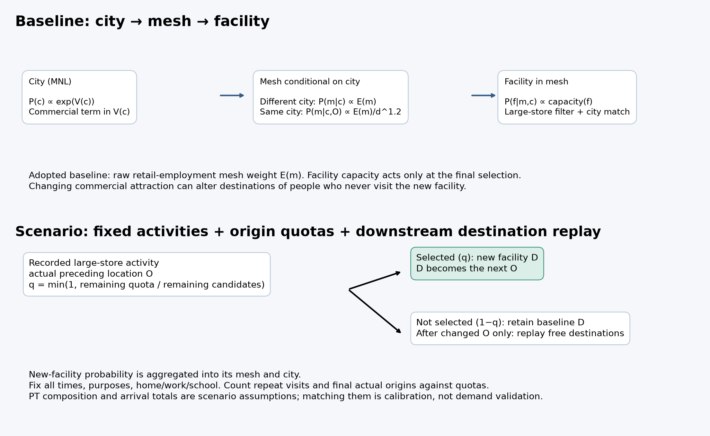
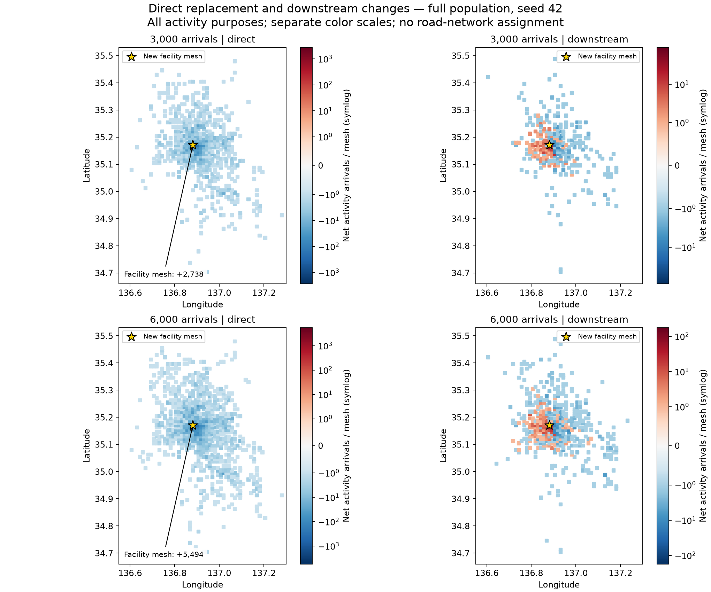

> 2026-10-14 本人訂正：本方式は比較対象B。主方式は入力・係数を変更して再生成するA。[訂正と現在地](20261014_A方式訂正とgamma入力確認.md)。

# 活動固定による新施設への転換と後続目的地の変化（2026-10-14）

## 結論と研究の位置づけ

本人が承認した実装計画に沿い、新施設への転換と、その後の自由目的地再選択を分ける任意の実行経路を追加した。全数seed42で買物到着3,000件・6,000件と39地区の整数配分枠を達成。実際の直前活動地で再集計した。これは**仮定した来訪需要を既存の活動系列へ整合的に反映し、店舗間の転換と後続移動による影響を分離して評価する方法**の動作確認であり、新施設需要の予測精度・実施設への外的妥当性の検証ではない。

PTは中村区着・大型規模小売店の買物の**愛知県内条件付き直前活動地点分布**を仮想施設の利用者構成として借用する。居住地分布ではなく、県外需要の再現とも呼ばない。入力した分布への適合を外部検証として扱わない。到着件数は延べ活動数で、実人数と区別する。

## 旧方式の監査：MCDの仮説を確認

`pflow_replay_diagnostics.py`で大型店フィルター修正後の保存済み全数を再集計した。集計表は買物到着のbaselineとの差。対象メッシュは座標、他メッシュの区分は小売施設所在地の対応表による。所在地が一意でないものを不明として残した。

|区分|3,000目標・実際3,038|6,000目標・実際6,110|
|---|---:|---:|
|新施設|+3,038|+6,110|
|対象メッシュの既存店|+3,620|−5,288|
|中村区の他メッシュ|−1,521|−199|
|中村区外の既存店|−5,110|−639|
|所在地不明|−42|−4|

**「中村区の他メッシュが純増しすぎる」という仮説は、この2ケースの集計では支持されなかった。** ただし新施設へ来ない人でも買物先が64,178／9,419活動で変更され、初回来訪前も34／11活動で変更されていた。初回来訪後（施設再来訪を除く）の変更は48／28活動。これは時間順の分類であり、旧方式の因果分解ではない。活動系列不一致594／104人を時間順集計から除外したため、施設到着分類も3,037／6,110件となる。

## 現行の三段階配分と新方式



採用baselineの買物先選択は、①市区町村MNL `P(c) ∝ exp(V(c))`、②市区町村内メッシュ、③候補施設のcapacity比例抽選。商業量は①の魅力項と②のメッシュ重みに作用する。買物のメッシュ重みEは卸売業・小売業従業者数。別都市では `P(m|c) ∝ E_m`、同都市では採用raw設定で `P(m|c,O) ∝ E_m/d(O,m)^1.2`。既定offの同都市では `log(1+E_m)`。指数1.2は現行switchのfall-throughを含む実動作。③の候補は大型店判定・都市一致処理を通す。新方式では市区町村魅力度・施設capacityの追加探索を行わない。

新方式はbaselineに対応づけた割当てで、独立な新施設効用係数の推定ではない。

1. baseline生成時の `--activity-trace on` で、人物ID・活動番号・開始時刻・目的・大型店分岐を `.csv.branches.tsv` に記録する。旧CSVから大型店を推測しない。乱数を追加消費しない。
2. PT構成比から最大剰余法で整数の地区別到着枠を作る。候補は記録された大型店買物だけ。
3. CSV名・人物・活動番号・seedから安定した抽選値を作り、実際の直前Oの地区について `q=min(1,残り枠/max(1,baseline上の未処理候補数))` で新施設へ転換する。再訪も枠を消費する。
4. 非選択かつ誘致の影響を受ける前ならbaselineのDをそのまま保つ。直接段階の条件付き配分は `P(D=new)=q`, `P(D=j)=(1−q)P0(j)` と整理できる。同じqの条件下で既存先間の比率を維持する結合であり、有限標本の地区別割当て後まで既存店比率が完全一致するという主張ではない。
5. 施設を含むメッシュ・市区町村では、確率に新施設のqが入る。例えば `P(m*)=q+(1−q)P0(m*)`。これは集約の整合であり、メッシュや区の**純増**が施設到着数と同じという意味ではない。
6. Oがbaselineから変わった後の自由目的地だけ既存MNLで再選択する。大型店分岐は再抽選しない。日時・目的・自宅/勤務先/学校を固定し、元の固定先等へ戻ってOが一致したら再選択を止める。後続の新施設選択も同じ到着枠の処理を通す。
7. 候補不足は `unfilled_quotas` と `status=unmet`、目的地選択失敗は `selection_failed_retained` として記録。通常買物で埋めず、活動を削除しない。

候補数の分母はbaselineの残候補数で、後続移動で変わる将来Oの候補数の厳密な予測ではない。したがって任意の入力で厳密達成できる保証はない。今回は全地区で一致した。ファイル・人物順を固定して処理する方式で、順序や割当て方式への感度は別の課題。

## 全数seed42の結果

|監査項目|3,000件設定|6,000件設定|
|---|---:|---:|
|実買物到着数|3,000|6,000|
|人数誤差|0%|0%|
|誘致した実人数|2,998|5,990|
|うち再来訪による到着|2|10|
|後続の自由目的地変更|618|1,249|
|後続選択失敗（元の目的地を保持）|1|4|
|活動日時・目的等の不一致|0|0|
|固定目的地の不一致|0|0|
|非誘致者の変更|0|0|
|通常買物から新施設への到着|0|0|
|地区別枠の未達|0|0|
|PT構成比とのTVD|0.001510|0.000797|

両ケースとも7,023,479人・28,057,110活動を保持。施設・対象メッシュ・所在市区町村への**新施設分の総到着**はそれぞれ3,000／6,000で一致。TVDは `0.5 Σ|実構成比−PT構成比|`。整数丸めの差が残るため、枠に一致してもTVDは厳密には0ではない。任意のTVD閾値を研究の妥当性基準にしない。目標0では構成比を定義しない（初期実験JSONの0.5は空分布を旧関数へ渡した値であり、評価対象外。実行スクリプトは現在nullを出す）。

選択失敗はすべて飲食活動（目的200）の `IllegalStateException`。活動行・元の目的地は保持されている。例外クラスまで記録済みで、候補なし等の詳細原因は未確定。失敗を成功と数えていない。

|新施設への転換元（出力所在地基準）|3,000|6,000|
|---|---:|---:|
|対象メッシュ|262|506|
|中村区の他メッシュ|359|745|
|中村区外|2,379|4,749|

転換元は対応するbaselineの買物先で、PTの直前Oとは別の量。出力gcodeによる区分類であり、不明位置を含めた旧方式の実店舗対応表の区分類とは混同しない。直接の新施設到着増と元の先の減少は一対一。新施設のメッシュの直接純増は+2,738／+5,494で、gross到着との違いは同メッシュ内転換分。



図は全目的の活動到着のメッシュ別差分。左は新施設への転換（再訪を含む）、右はそれ以外の後続目的地変更。各パネルは異なる色スケールの対称対数表示。メッシュごとの地点差分で、道路ネットワークへの配分・通行者数は未計算。再訪を左へ分類するのは処理上の理由別分解であり、媒介効果を統計的に同定した因果分解ではない。

## 2%のseed感度

|seed|全数相当目標|標本の実到着|TVD|後続変更|再訪|
|---|---:|---:|---:|---:|---:|
|42|3,000|60|0.071197|12|1|
|42|6,000|120|0.040015|21|1|
|43|3,000|60|0.071197|12|1|
|43|6,000|120|0.040015|26|2|
|44|3,000|60|0.071197|18|0|
|44|6,000|120|0.040015|24|0|
|45|3,000|60|0.071197|13|0|
|45|6,000|120|0.040015|19|0|

目標人数と地区別枠は固定しているので、TVDはseed間で一致する。変動するのは誘致される人物・店舗間転換・後続先である。2%では60／120件の整数丸め誤差が大きく、全数とのTVD差をモデル性能向上とは解釈しない。

## 確認したテスト

- Java11テスト（大型店フィルター4、活動固定7）成功。目標0、通常買物除外、直接変更のみ、D→次のO、固定活動、再訪の実O枠、失敗保持、候補不足、乱数再現を確認。
- Python132テスト成功。枠の合計・入力検査、分岐記録の対応、独立監査の改変検出を含む。
- 判定記録付き全数baselineを元の施設なしbaselineとSHA256比較し、207 CSVすべて一致（`trace_baseline_comparison.json`）。
- 既定offで従来207 CSVと完全一致。2%seed42の目標0もbaselineの207 CSVとバイト一致。
- 2%seed42の3,000目標を再実行し207 CSV完全一致。
- 2%の直接効果のみの実験で後続変更0、新施設への増加と元の先の減少が一致。新施設以外の地点を増加させる書換え0。
- 全数はJava自己集計とは別のPython監査で行単位の固定性・最終O・目的別制約を確認。原データの不正や未到達を隠して活動系列を置換する処理はない。

## 実行方法・保存先

Java: `FixedActivityReplay.java`、補助記録 `ActivityTrace.java`。通常の生成とは別mainを起動するため、既定生成経路は従来のまま。Javaの従来CRLFファイルはCRLFを維持。実行前に `bash scripts/test_facility_filter.sh` でコンパイルとテストを行う。

baselineは施設なしの採用設定で `--activity-trace on` を追加して生成する。既存CSVだけでは実行不可。設定・正確なコマンドは `baseline_commands.json` に保存した。

```sh
# ppflow_change_automatic から実行。outputは未使用のディレクトリを指定する。
.venv/bin/python pflow_fixed_activity.py \
  --baseline /Volumes/PFLOW_SSD/PFLOW/output/fixed_activity_20261014/seed42_full/baseline \
  --pt-csv ../中京PTデータ/chukyo_pt_2022_od_d5_shopping_facility_age.csv \
  --pflow-home /Volumes/PFLOW_SSD/PFLOW \
  --output /Volumes/PFLOW_SSD/PFLOW/output/fixed_activity_next \
  --targets 3000 6000 --sample-factor 1 --seed 42
```

`--direct-only` は直接転換だけ、`--targets 0` は不変性確認。任意施設では `--longitude --latitude --gcode --mesh-code` を合わせて指定。AIを介さず枠配分・抽選・後続選択・監査まで実行する。1 JVM、heap6 GiB。全数はSSD、2%はローカル。出力形式は従来10列のCSV、追加監査は `audit.tsv`, `replay_summary.json`, `verified.json`, `mesh_effects.csv`, `city_effects.csv`。元データ・実験結果の上書きは拒否する。

- 全数: `/Volumes/PFLOW_SSD/PFLOW/output/fixed_activity_20261014/seed42_full_replay/`
- 2%・旧方式監査・実行ログ: `.local/pflow/output/fixed_activity_20261014/`
- 持ち運べる要約・監査・地区別件数/構成比: [summary.json](figures/20261014_fixed_activity/summary.json), [results.csv](figures/20261014_fixed_activity/results.csv), [origin_composition.csv](figures/20261014_fixed_activity/origin_composition.csv)
- 図の再生成: `pflow_fixed_activity_report.py --local .local/pflow/output/fixed_activity_20261014 --full /Volumes/PFLOW_SSD/PFLOW/output/fixed_activity_20261014/seed42_full_replay --output docs/progress/figures/20261014_fixed_activity`

## 次の課題

1. 【仮】後続目的地変化を距離帯・目的別に評価し、周辺への変化が既存MNLの仮定にどれほど依存するか確認する。今回の全数はseed42だけ。
2. 飲食の1／4件の選択失敗の詳細原因を追跡する。現段階では元の行き先保持という定義を明示する。
3. 固定した日時のままで変更先への移動時間が実現可能かは未検証。交通手段・経路・時空間的実現可能性を検証する。
4. 床面積からの需要予測と、実施設データによる独立検証は別課題。PT地区配分一致だけで需要・転換元・波及の現実性を主張しない。
5. 商業量探索の拡大は後順位。学会では入力仮定、保持した条件、直接転換、後続変更、未検証事項を明示する。

根拠: 本人承認の実装計画、`mcd/mtg/20261014/summary.md`、今回実行したログと監査。MCDの配分整合・粒度・校正と検証の区別に対応した。
