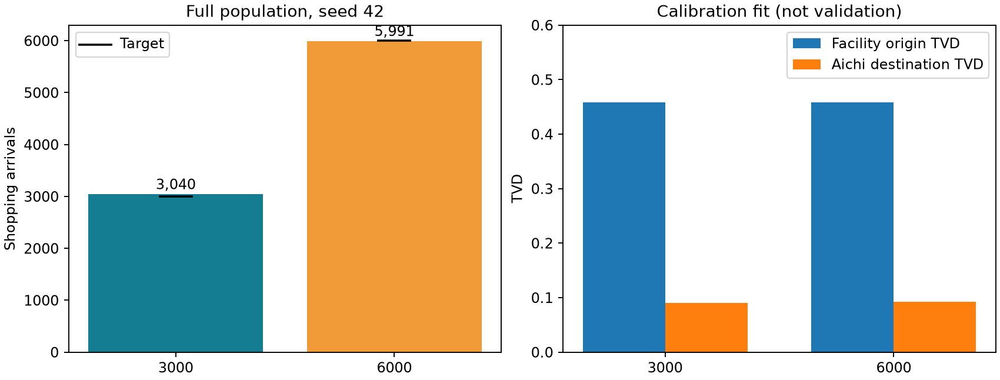
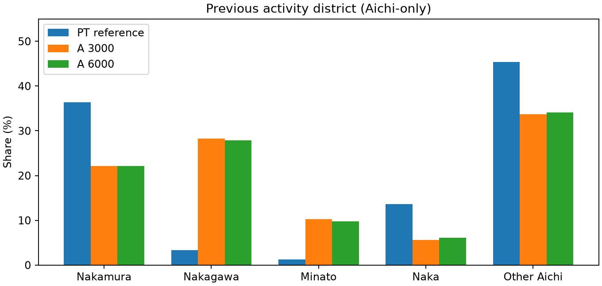

# 主方式A：閉店後基準の自動校正（2026-10-15）

入力と係数だけを変更してJavaを再実行した。生成後CSVの書換え・地区枠・来訪者の選び直しは行っていない。人数は設定した±2%を満たすが、PT出発地分布には大きなずれが残る。大域最適・実施設需要の予測とは主張しない。

## 全数seed42の確認結果

|目標|実到着|人数誤差|出発地TVD|愛知県内ODの行先TVD|中村区買物|対象メッシュ買物|通常買物→新施設|
|---|---|---|---|---|---|---|---|
|3,000|3,040|+1.33%|0.458750|0.090114|65,562|13,361|0|
|6,000|5,991|-0.15%|0.458073|0.092933|72,609|26,431|0|

### 2%のseed感度（最終pilot回、校正途中の入力）

|目標|seed42|seed43|seed44|seed45|平均の全数換算|
|---|---|---|---|---|---|
|3000|50|77|54|60|3012.5|
|6000|114|142|126|102|6050.0|

seed列は2%の実到着数。全seedが人数±2%に入ったという意味ではない。この後に全数の人数フィードバックで入力を更新しており、最終入力の全数seed43〜45感度は未検証。

到着数は延べ買物活動数で、ユニーク人数ではない。施設IDで識別し、同じ座標の残存店舗を含めない。PTは中村区着・大型規模小売店・買物の直前活動地点、愛知県内条件付き。行先TVDもO・Dとも愛知県内の買物に限定する。6,000側の県外・不明Oが1件あり、条件付きTVDの分母から除く。

## 最終入力

|目標|γ指標加算（3402行数相当）|距離倍率|meshCapacityAdd|施設capacity|
|---|---|---|---|---|
|3000|1524.2920397685953|0.6904602744556604|7564.134664324618|993349894.4132231|
|6000|0.6147906166191356|0.6901030403858693|18863.0511472652|1000000000.0|

出発地残差の例（愛知県内構成比）：3,000側の中川区は28.29%（PT3.35%）、中村区は22.17%（PT36.36%）、港区は10.26%（PT1.24%）。地区別全表は `figures/20261015_gamma_A/origins.csv`。共有メッシュの市区町村間フォールバックや区内メッシュ距離重みの寄与は【仮】で、原因別寄与をまだ分離していない。

目的関数は人数相対誤差² + **0.1 × 出発地TVD + 1.0 × 全県行先TVD**。期待人数を合わせる施設capacityを内側で解き、外側の3変数を有界Nelder–Meadで探索する。候補不足時には人数ペナルティを加える。2% seed42〜45を2回、全数seed42を2回実行。全数の人数フィードバックも入力変更と再生成で行った。地区別補正はない。

施設capacityは上限10億付近。meshCapacityAddも閉店時減算745.943に比べ大きく、校正値を実際の従業者数・床面積と解釈しない。3,000と6,000でγ指標加算が大きく異なり、単一の実店舗規模を同定できたとはいえない。

## 係数推定と採用

本人決定でln(1+3402行数)の(b)を採用。元JSONの`log1p_area`というキー名は面積を意味しない。54,374㎡をこの指標へ直接加算していない。

|項|a推定値（数値標準誤差）|b推定値（数値標準誤差）|
|---|---|---|
|gamma|0.064146732 (0.000925849)|0.011720855 (0.000907784)|
|beta|—|0.435905864 (0.002932873)|
|distance_multiplier|0.932942277 (0.000669461)|0.917112076 (0.000663904)|
|area_multiplier|0.060562807 (0.002355907)|-0.082663051 (0.002280559)|
|population_multiplier|-0.750362362 (0.055861319)|-4.266766914 (0.056663754)|
|office_multiplier|-0.199479519 (0.015127996)|-0.974248994 (0.010729307)|

|指標|モデル|AIC|ホールドアウト行先TVD|
|---|---|---|---|
|log1p_area|a|3108651.270|0.091293|
|log1p_area|b|3086512.720|0.090641|
|presence|a|3107360.772|0.084724|
|presence|b|3086609.555|0.089056|

a: 対数尤度 -1554320.635219、AIC 3108651.270437、ホールドアウト出発地からの行先TVD 0.091293。

b: 対数尤度 -1543250.359955、AIC 3086512.719910、ホールドアウト出発地からの行先TVD 0.090641。

標準誤差はPT拡大集計値の数値曲率であり、調査設計を考慮した標準誤差ではない。ホールドアウトは一宮市発の都市選択適合で、既存大型施設の来訪者構成を独立検証した結果ではない。

## 閉店・新設による変化

閉店前と閉店後、新設ありで同じ距離倍率を用いる比較を別に生成する。距離倍率0.917の既存baselineと0.690の新設結果をそのまま施設効果として差し引かない。

|目標設定|状態|標本倍率|中村区買物|区外Oから中村区|対象メッシュ|行先TVD|
|---|---|---|---|---|---|---|
|3000|preclosure_f50|50|1204|823|80|0.091846|
|3000|postclosure_f50|50|1162|787|53|0.092436|

3000 closure_paired_comparison: `{"aligned_persons": 140563, "changed_shopping_events": 585, "nonvisitor_changed_shopping_events": 585, "changed_shopping_persons": 571, "nonvisitor_changed_shopping_persons": 571, "unaligned_persons": 6, "unaligned_nonvisitor_persons": 6}`
|6000|preclosure_f50|50|1204|823|80|0.091693|
|6000|postclosure_f50|50|1162|787|53|0.092706|

6000 closure_paired_comparison: `{"aligned_persons": 140566, "changed_shopping_events": 591, "nonvisitor_changed_shopping_events": 591, "changed_shopping_persons": 576, "nonvisitor_changed_shopping_persons": 576, "unaligned_persons": 3, "unaligned_nonvisitor_persons": 3}`

全数CSVは外付けSSDに保存。10/15の再開時にSSDが未接続のため、全数の係数一致baseline生成と新施設非来訪者の変更件数監査は未完了。全数値は内蔵側に保存された`report.json`を読んだ値で、このターンでSSD上CSVを再集計した値ではない。

## 活動固定Bとの比較

|方式|3,000目標の実数/TVD|6,000目標の実数/TVD|解釈|
|---|---|---|---|
|A（今回）|3,040 / 0.458750|5,991 / 0.458073|入力を変えて活動生成し直す|
|B（保存済み旧実験）|3,000 / 0.001510|6,000 / 0.000797|地区別整数枠への割当て|

Bは閉店前・旧メッシュ52366700の別条件。方式の性質を示す参考比較であり、同条件の優劣比較ではない。Bの小さなTVDは入力枠への適合で、予測精度を意味しない。出典 `figures/20261014_fixed_activity/results.csv`。

## 再実行・出力先

最終scenario/gamma設定は `figures/20261015_gamma_A/t3000_{scenario,gamma}.json` および `t6000_{scenario,gamma}.json` に複製保存した。個別の実行コマンドは`figures/20261015_gamma_A/summary.json`の`targets.*.command.command`、元ファイルは `.local/pflow/output/gamma_A_52365790_20261014/t3000_full1/command.json` と `t6000_full1/command.json`。全数CSVは `/Volumes/PFLOW_SSD/PFLOW/output/gamma_A_52365790_20261014/t{3000,6000}_full1/scenario/23`。

```sh
.venv/bin/python pflow_gamma_controls.py --report .local/pflow/output/gamma_A_52365790_20261014/report.json --output .local/pflow/output/gamma_A_controls_20261015 --resume
.venv/bin/python scripts/report_gamma_a.py
```

最終パラメータでのv1→v2感度も確認した（補正前期待値：3,031.875→3,030.650、5,953.208→5,950.822）。出典 `figures/20261015_gamma_A/final_parameter_surrogate_sensitivity.json`。この差だけで出発地TVDの大きな残差を説明することはできない。近似モデルv1では病院・飲食店由来の一部共有メッシュ所属が欠けた。v2修正で初回3,000候補の期待数は2,999.978→2,998.765（約−0.04%）。今回の探索はv1、最終人数はJava実生成の値。近似はbaselineのO・活動を固定するため、連鎖的変化は実生成でしか評価できない。





全数seed感度、同条件B比較、既存施設による独立検証、床面積からの需要予測は未完了。
