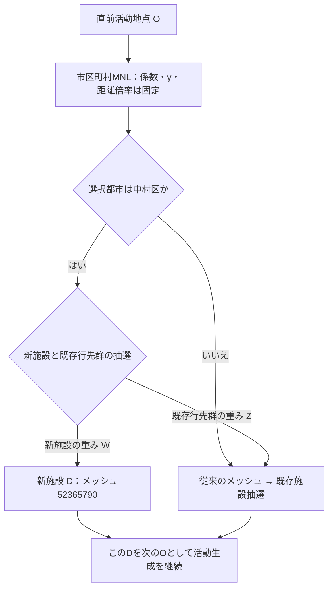

# 新施設専用重みの選択式（2026-10-15）

実装出典：`Pseudo-PFLOW-v3/src/pseudo/gen/ActGenerator.java` の `choiceFreeDestinationByMnl`、`chooseIndependentFacility`、`choiceByFacilityCapacity`、`choiceByDistanceWeightedCapacity`。Java commit `740d33d`。新施設重みを未指定の既定処理は従来どおり。

## 市区町村を選んだ後の条件付き確率

市区町村の選択確率を \(p_c(O)\)、既存メッシュmの重みを \(a_m(O)\)、その和を \(Z(O)=\sum_m a_m(O)\) とする。新施設の独立重みを \(a_*(O;W)\) とすると、中村区を選んだ後の新施設確率は

\[
q_*(O;W)=\frac{a_*(O;W)}{Z(O)+a_*(O;W)}.
\]

区外Oから中村区を選んだ場合、\(a_m=C_m, a_*=W\)。区内Oの場合、今回のraw設定では \(a_m=C_m/d(O,m)^{1.2}, a_*=W/d(O,m_*)^{1.2}\)。Javaの距離はkm、中心まで0の場合は新設ゲート内で1e-9kmへ下限処理する。1.2は実コードのswitchのfall-throughによる指数で、MNLの距離倍率0.9171120757320695とは別。

既存施設fへの元の条件付き確率を \(r_f(O,c)\) とすると、新方式では

\[
P(D=f\mid O,c=23105)=(1-q_*)r_f(O,23105).
\]

従って既存f,g同士の確率比 \(P(f)/P(g)=r_f/r_g\) は不変。ただし無条件の既存施設確率・人数すべてを不変にしたまま新施設に確率を追加することはできない。対象メッシュ全体への新施設分の確率は、既存店舗分と新施設分を合計して得られる。

## 変更しない入力と、変わり得る出力

- 専用重みWは市区町村MNLに入らない。新施設は中村区を選んだ活動だけの候補。
- meshCapacityAddは745.942954248366で固定。既存mesh容量をWと一緒に増やさない。
- 新施設を通常の店舗リストへ挿入しないため、共有メッシュ経由で別の選択都市から新施設へ漏れない。
- 新施設用乱数を人物別の別ストリームにし、新施設を選ばなかった活動の従来抽選をずらさない。
- 来訪後はOが変わる。後続行先・選択失敗・最終的な都市別到着数は変わり得る。A方式は活動固定を保証するものではない。
- 全数の比較では「閉店後baseline」と「固定入力を新設とそろえた重み0」を別々に用いる。後者が専用重みの効果の対照、前者は固定γ・固定capacity復元も含めた新設シナリオ全体の対照。

## 研究上の位置づけ

Wは外部から与えた延べ来訪件数を再現する校正値で、床面積や実従業者数の推定値ではない。PT参照は大型店買物、今回の利用候補は通常買物も含む。人数適合と出発地TVDを分けて報告する。人数を1パラメータで合わせた後、PT分布を独立に動かす自由度はない。
