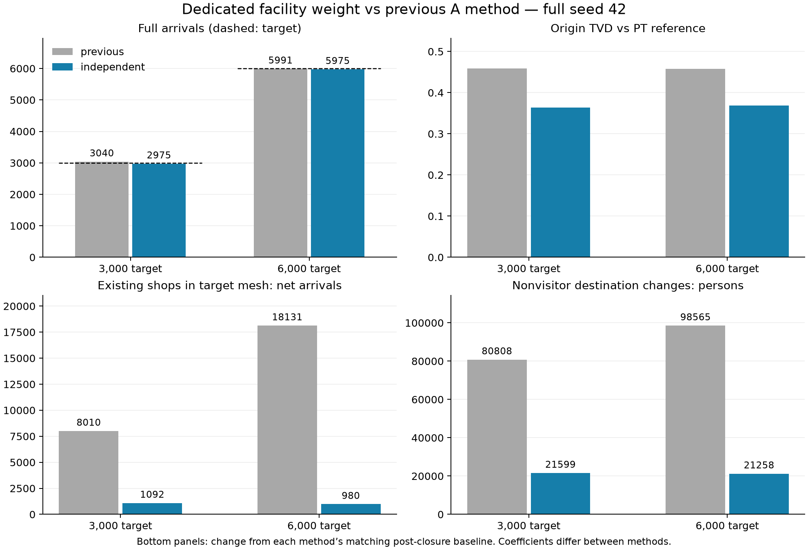

# 新施設専用重みのA方式校正（2026-10-15）

最終確認：2026-10-16。全数seed42・最終重み2%seed42〜45・2種類の全数対照比較・実CSV再集計まで完了。

**人数を合わせる重みを新施設に限定できた。** 3,000→2,975件、6,000→5,975件で±2%を達成。固定入力をそろえた重み0対照では、対応系列の非来訪者の買物先変更は両方0人。6,000側だけ系列不一致の非来訪者1人を別計上し、「全員不変」とはしない。跡地既存店は同対照比−110／−222件で、重みと一緒に増える挙動は見られなかった。

閉店後baselineと比べると、固定γ・capacity復元も含むため非来訪者変更21,599／21,258人が残る。PT出発地TVD0.363320／0.368257も残り、人数適合を需要予測・PT再現の成功とは呼ばない。前回Aとは係数・通常買物の対象範囲も異なる。

[選択式と処理図](20261015_専用重み選択式.md)／[一次集計](figures/20261015_independent_A/summary.json)／[実CSV再集計](figures/20261015_independent_A/full_reaudit.json)



図の下段は**各方式の閉店後baselineとの差**。専用重み単独の比較は本文の `fixed_inputs_zero_weight` 行を参照。

## 設計

外部需要3,000・6,000件を入力し、モデル内では専用重みWだけを調整する。CSVの書換え・枠割当て・来訪者の選び直しは行わない。

市区町村は従来MNLで選ぶ。選択都市が23105の場合だけ、新施設と既存行先全体の二択を行う。区外Oでは既存メッシュcapacity合計をZとして、新施設確率はW/(Z+W)。区内Oでは、既存各メッシュと新施設の双方に従来の距離減衰（指数1.2）を適用して同じ式を用いる。対象メッシュ内の新施設を独立した選択肢として市内既存メッシュ群と並べ、既存メッシュのcapacity自体にはWを加えない。

新施設を選ばなければ従来のメッシュ→施設抽選をそのまま行う。条件付き既存行先の相対比は維持するが、確率の和が1なので既存行先の無条件確率は新施設分だけ下がる。「既存店の絶対人数が不変」とは主張しない。新施設抽選専用の人物別乱数を用い、非選択の場合の従来乱数列を維持する。来訪後は新しいOから通常の活動生成を続ける。

## 固定入力

- `config/gamma/adopted_b.json` の(b)係数、距離倍率0.9171120757320695。
- 旧店306行を除外。γ指標19行に306行を戻して325行。面積単位ではない。
- 旧店capacityを減算後、meshCapacityAdd=745.942954248366を固定加算。
- `config/gamma/analysis_target.json`：中村区23105、メッシュ52365790、経度136.88665075・緯度35.16649051、施設ID900000001。
- `independentFacilityWeight` を設定した時だけ新方式。未設定は従来方式。`--large-store-facility-only off` で通常買物も対象、onなら大型店分岐だけ。都市一致はon、新方式は共有メッシュでも都市制限を強制。
- PT参照は中村区着・大型店買物・直前活動地点の県内条件付き分布のまま。今回の来訪候補は通常買物を含むため、参照集団の違いを留保し、外部妥当性検証と呼ばない。

## 検証・実行状況

Java22テスト成功（実装時）。Pythonは通知・検証追加後の155テスト成功。新規Java4テストで都市制限、通常買物切替、既存条件付き比率と非選択時の抽選一致、同seed・重み0を確認。
既定出力 `.local/pflow/output/independent_A_20261015/default/baseline/23` は207 CSV、従来 `capacity_experiment/baseline/23` と `diff -rq` 差分なし。生成ログ異常なし。

2%・全数・対照比較は完了。実験結果は `.local/pflow/output/independent_A_calibration_20261015/report.json` に保存。各ケースの `command.json`、`scenario.json`、`gamma.json` が正確な実行入力。最終入力と実測値は下表に記載。

```sh
.venv/bin/python pflow_independent_calibration.py --output .local/pflow/output/independent_A_calibration_20261015 --pilot-only
# 試行完了後、SSD接続の上で全数へ進む
.venv/bin/python pflow_independent_calibration.py --output .local/pflow/output/independent_A_calibration_20261015 --resume
```

人数の計算上の許容幅は全数±2%。1重みでは人数とPTを独立に最適化できないため、TVDは結果として報告する。前回の自由な距離・γ・mesh capacity調整は行わない。

## 途中確認：重みだけを変えた2試行（2% seed42）

専用重み4,000→4,615.384615384615で新施設52→57件（全数換算2,600→2,850）。跡地既存店は71→71、中村区買物1,159→1,159、区外Oから中村区648→648。
対応した140,569人のうち、買物先が変わったのは5人・5活動。非来訪者の買物先変更0人、系列不一致0人。単一seed・小標本・この2重み間の確認に限る。
出典：`t3000_pilot0_s42/metrics.json`、`t3000_pilot1_s42/metrics.json`、`pilot_weight_pair.json`（いずれも `.local/pflow/output/independent_A_calibration_20261015/`）。

## 確定した実験結果

到着は延べ買物活動数。人数適合は外部から与えた需要への校正であり、需要予測ではない。前回と今回で固定係数も異なるため、差を専用重みだけの効果とは解釈しない。

|方式・目標|到着|誤差%|出発地TVD|全県行先TVD|中村区買物|区外O→中村区|跡地既存店|通常買物→新施設|
|---|---:|---:|---:|---:|---:|---:|---:|---:|
|前回A 3000|3040|+1.33|0.458750|0.090114|65562|45540|10321|0|
|専用重みA 3000|2975|-0.83|0.363320|0.093417|58173|32456|3536|2293|
|前回A 6000|5991|-0.15|0.458073|0.092933|72609|51611|20440|0|
|専用重みA 6000|5975|-0.42|0.368257|0.093405|58197|32473|3424|4599|

## 対照との差

閉店後対照はγ19・mesh加算0。重み0対照はγ325・mesh加算745.942954248366を新設ケースとそろえたもの。前回Aは各目標の最終距離係数をそろえた閉店後対照。非来訪者の変更人数は活動系列が対応した人物の空間的な買物先変更で、系列不一致は別に記す。

|目標・対照|中村区増減|区外Oからの増減|跡地既存店増減|非来訪者変更人数|非来訪者系列不一致|
|---|---:|---:|---:|---:|---:|
|3000・closed|+1884|+1406|+1092|21599|112|
|3000・fixed_inputs_zero_weight|+33|+18|-110|0|0|
|3000・前回A閉店後対照|+9298|+7531|+8010|80808|696|
|6000・closed|+1908|+1423|+980|21258|113|
|6000・fixed_inputs_zero_weight|+57|+35|-222|0|1|
|6000・前回A閉店後対照|+16351|+13596|+18131|98565|969|

## 最終重みと2%感度

|目標|専用重み|全数±2%達成|seed42実件|seed43実件|seed44実件|seed45実件|
|---|---:|---|---:|---:|---:|---:|
|3000|4625.908557352593|True|58|60|72|63|
|6000|10105.263157894737|True|117|126|138|106|

|目標|4seed平均（全数換算）|最小〜最大（全数換算）|
|---|---:|---|
|3000|3162.5|2900〜3600|
|6000|6087.5|5300〜6900|

各seedは2%の実件数、全数相当は50倍。全数で合わせた重みを共通使用しており、各seedを別個に校正したものではない。各seedのTVDは `figures/20261015_independent_A/seeds.csv`。

## 出典と制約

- 正確なコマンド・固定係数：`figures/20261015_independent_A/commands.json`。最終scenario/gammaも同ディレクトリに保存。
- 一次集計：`summary.json`、地区別PT比：`origins.csv`、メッシュ増減：`mesh_changes.csv`。
- Javaの選択失敗（非0戻り人数）は `generation_status.json`。例外なしを失敗0と呼ばない。
- PTは大型店買物、今回の候補は通常買物を含む。母集団の違いを残す参考適合である。
- 重みの調整は新施設に限定しているが、来訪後のO変更と活動生成失敗の変化は後続へ波及する。
- 既存行先間の条件付き確率比の不変性と、最終出力の非来訪者・既存店の絶対人数の不変性を区別する。

## 監査と残る課題

- 保存済み `full_reaudit.json` は両ケースの実CSVからの再集計。全ての整数件数・地区別件数は一次集計と完全一致。TVDは走査順に伴う浮動小数点丸め差のみ1e-12まで許容する。
- 重み0対照→3,000は活動系列不一致0、→6,000は1人（非来訪者）。既存Javaの非0戻り人数はCommuterで40,670→40,671、他コホートは不変。個人単位の原因は未特定で、この一致だけでは原因を断定しない。
- 閉店後対照の非0戻り人数はCommuter40,675、NonCommuter52,836、Student3,196。重み0対照と3,000は40,670／52,832／3,195。詳細は `generation_status.json`。生成コマンド正常終了と、全人物の生成成功は区別する。
- 前回Aより既存店の増加と非来訪者の変更は減ったが、モデル変更の各要因別寄与を同定した比較ではない。
- 学会で示せるのは、仮定需要への校正と、その調整を施設に限定する設計・実測監査。床面積需要予測、実施設データによる独立検証、同条件B比較、全数seed43〜45は別課題。
